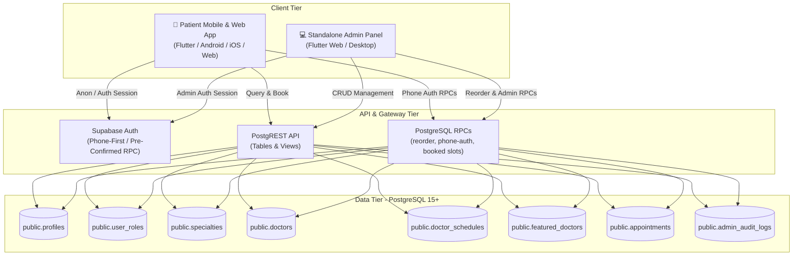
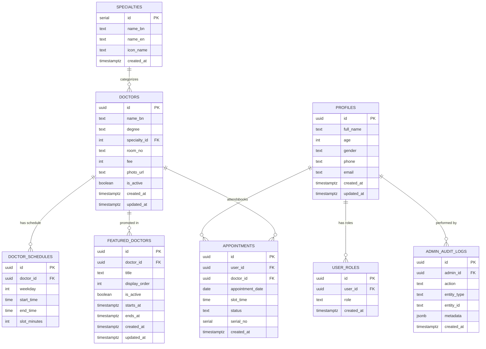

# 🏥 NATIONAL HOSPITAL CHATTOGRAM — TOP DOCTORS + WEB ADMIN PANEL
## Complete Architectural Requirements & Technical Specification Document

---

## 1. Executive Summary

This document specifies the complete system architecture, functional requirements, database schemas, security rules, and user interaction designs for the **National Hospital Chattogram** digital healthcare platform:

1. **Patient Portal (Mobile & Web App)**: A streamlined, patient-first Flutter application focused on seamless doctor discovery, real-time chamber schedule lookups, phone-first authentication, Top Doctors highlights, and digital appointment serial booking.
2. **Standalone Web Admin Panel (`/admin_panel`)**: A decoupled, production-grade Flutter Web back-office management console for hospital administration, medical coordinators, and reception desks to manage doctor rosters, rank featured specialists, configure visiting hours, monitor appointment queues, and track audit logs.
3. **Backend & Persistence (Supabase / PostgreSQL 15+)**: A unified relational database providing Row Level Security (RLS), custom RPC stored procedures, atomic transaction management, and role-based access control (RBAC).

---

## 2. High-Level System Architecture



---

## 3. Database Specification & Schemas

### 3.1 Relational Entity-Relationship Diagram



### 3.2 Key Database Stored Procedures (RPCs)

1. **`register_user_with_phone`**:
   - Provisions pre-confirmed auth accounts in `auth.users` and maps corresponding `public.profiles` entries without triggering external SMTP rate limits.
2. **`get_auth_email_for_login`**:
   - Resolves login identifiers (11-digit Bangladeshi mobile number or standard email) to internal authenticated canonical email strings (`<phone>@patient.nationalhospital.com`).
3. **`reorder_featured_doctors`**:
   - Atomic transaction reordering of hero featured doctors. Swaps or shifts `display_order` without partial constraint violations.
4. **`is_admin(uuid)`**:
   - Security-definer RBAC function validating whether a requesting user token possesses an active `admin` role in `public.user_roles`.
5. **`get_booked_slots(uuid, date)`**:
   - Returns reserved time slots for a specific doctor on a selected date to prevent concurrency collisions.

---

## 4. Top Doctors (Hero Specialists) Feature Specification

### 4.1 Objectives
The **Top Doctors** feature spotlights premier consultants and department heads to help patients quickly identify recognized specialists and book high-priority chamber visits.

### 4.2 Functional Requirements
- **Dynamic Bengali Badges**: Sequential badges (`#১ সেরা`, `#২ সেরা`, `#৩ সেরা`...) rendered using Bengali numeral formatting.
- **Active & Scheduled Display**: Configurable validity window (`starts_at`, `ends_at`) and global active toggle (`is_active`). Expired promotions auto-hide from patient view.
- **Atomic Rank Management**: Admin reorder controls (up/down shift arrows and explicit index input) executed through the transactional `reorder_featured_doctors` RPC.
- **Chamber Detail Preview**: Card displays consultant degrees, designation, chamber room, visiting schedule, consultation fee, and a direct "বুকিং" (Book Now) action.

---

## 5. Standalone Web Admin Panel Specification

### 5.1 Architecture & Security
- **Decoupled Architecture**: Located in `/admin_panel`, completely isolated from patient app dependencies, routes, and UI layers.
- **Role-Based Access Control (RBAC)**: All mutations and data access gated by `is_admin(auth.uid())` checks enforced at both the UI shell and database RLS levels.
- **Responsive Layout**: Collapsible sidebar navigation, live stat metric cards, table views with pagination, and search/filter toolbars.

### 5.2 Admin Modules

| Module | Route | Capabilities |
|:---|:---|:---|
| **Dashboard** | `/dashboard` | Live operational metric counters (total doctors, active chambers, today's appointments, featured specialists). |
| **Top Doctors Manager** | `/top-doctors` | Visual rank reordering, activation toggling, promotional date window assignment, doctor picker modal, live mobile card preview. |
| **Doctor Directory** | `/doctors` | Full CRUD operations: name, credentials/degrees, specialty assignment, room number, fee, active status toggle. |
| **Specialties Manager** | `/specialties` | Manage clinical department titles, Bengali localization, and icon references. |
| **Chamber Schedules** | `/schedules` | Configure weekly visiting days (Saturday–Friday), shift start/end times, and slot duration intervals. |
| **Appointments Oversight** | `/appointments` | Daily appointment queue monitoring, status filtering (`booked`, `confirmed`, `cancelled`), and serial lookup. |
| **Audit Logs** | `/audit-logs` | Immutable audit stream capturing administrative actions, modified entity types, and timestamps. |

---

## 6. Patient App Specification

### 6.1 User Experience & Design Language
- **Typography**: Bengali-first typography powered by Google Fonts `Hind Siliguri`.
- **Palette**: Medical Cerulean Blue (`#006096`), Royal Blue (`#0060A8`), Verified Mint Green (`#006A42`), and Clean Canvas (`#FAF8FF`).
- **Brand Launch**: 4-second animated splash screen featuring the 3D high-resolution hospital emblem.
- **Mobile First Navigation**: 4-tab bottom navigation shell (`হোম`, `ডাক্তার`, `বুকিংস`, `প্রোফাইল`).

---

## 7. Migration Sequence

Execute migration scripts in the Supabase SQL editor in strict numerical order:
1. `supabase/schema.sql` — Core database tables, triggers, RLS policies, and phone auth RPCs.
2. `supabase/update_phone_auth.sql` — Extended phone-first auth helper functions.
3. `supabase/seed_scraped_doctors.sql` — 100+ verified doctor profiles, clinical specialties, and weekly chamber visiting schedules.
4. `supabase/featured_doctors_and_admin.sql` — Featured doctor management, RBAC, reorder RPC, and audit logging tables.

---

## 8. Verification & Test Suite

All code in this repository adheres to zero static analysis warnings and passes comprehensive widget and unit tests:

```bash
# Patient App Verification
flutter analyze
flutter test

# Standalone Admin Panel Verification
cd admin_panel
flutter analyze
flutter test
```
