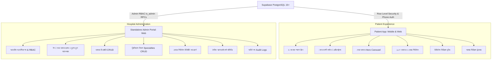
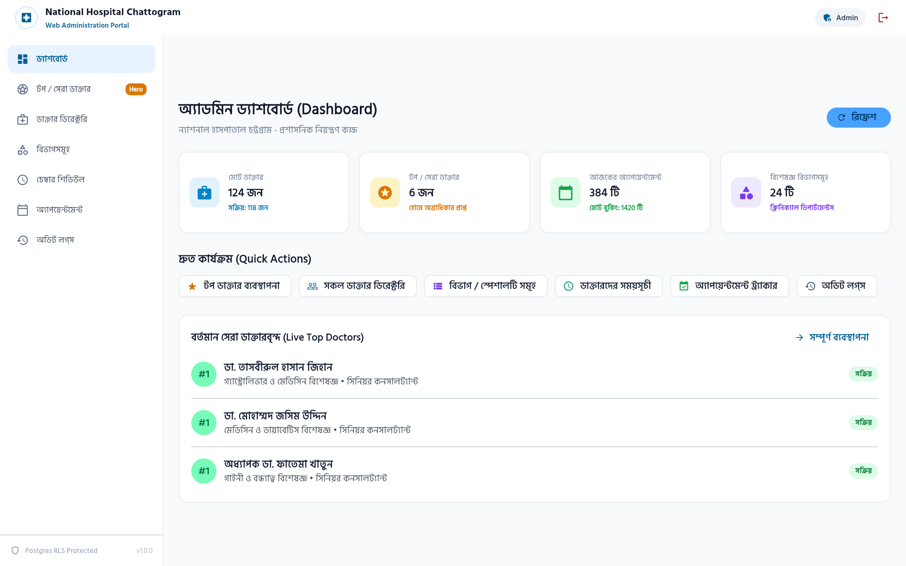
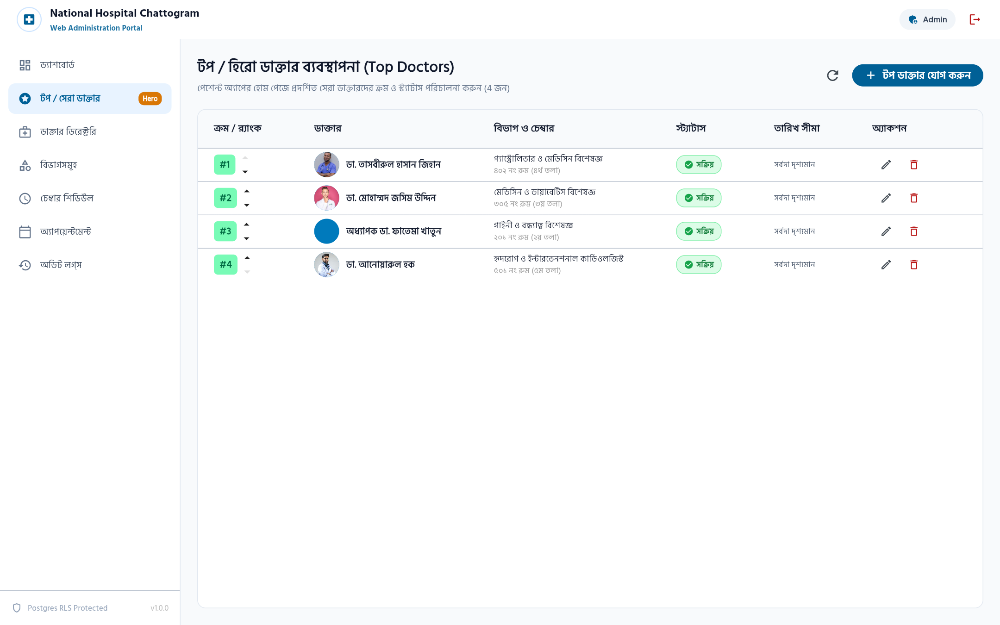
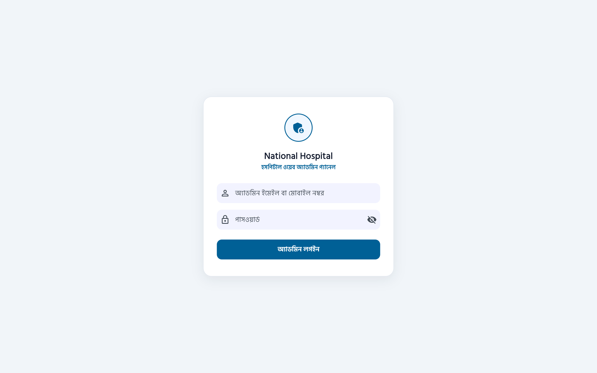
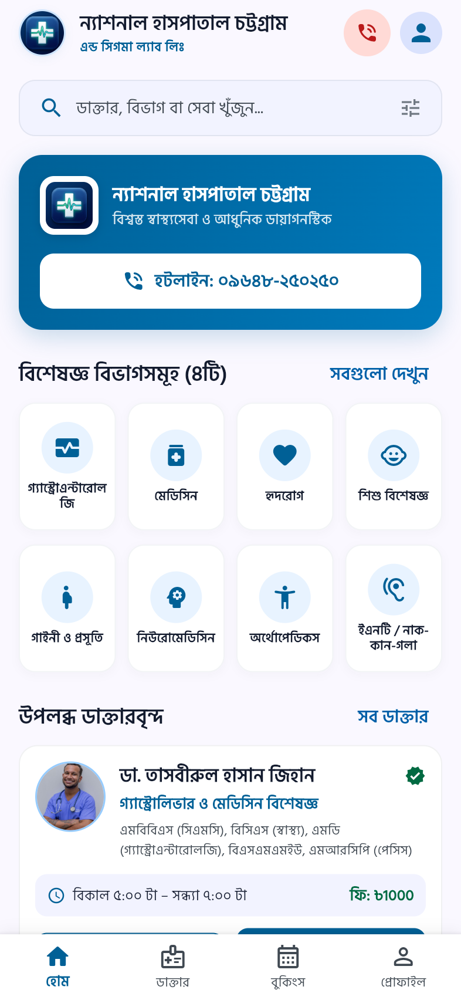
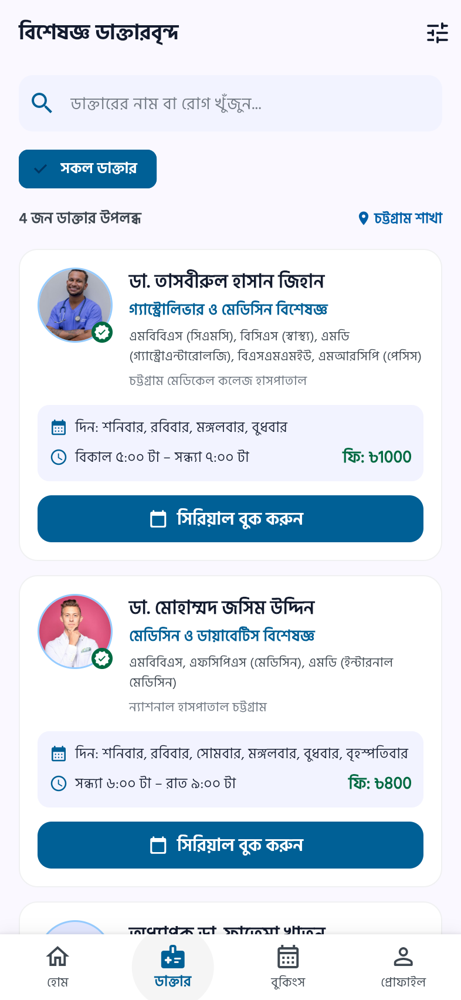
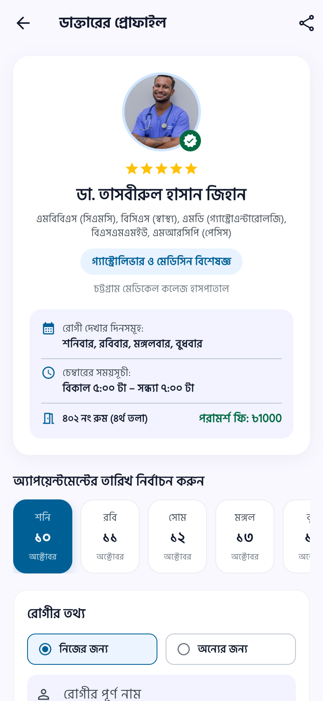
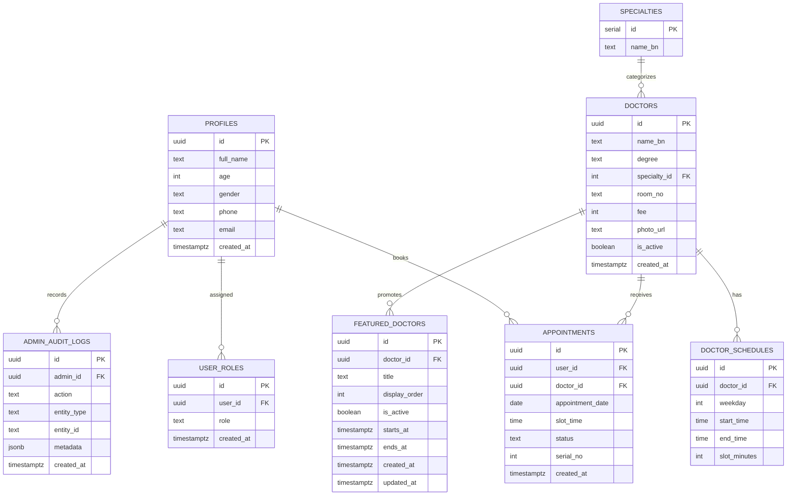

# 🏥 National Hospital (ন্যাশনাল হাসপাতাল চট্টগ্রাম)

> **Official Patient Portal, Doctor Appointment & Hospital Web Admin Management System**  
> A decoupled multi-project Flutter & Supabase ecosystem for National Hospital Chattogram, Bangladesh:
> 1. **Patient App (`/`)**: Mobile & web patient portal for real-time doctor chamber schedules, digital serial booking, phone-first auth, and Top Doctors highlights.
> 2. **Standalone Admin Panel (`/admin_panel`)**: Standalone web control panel for hospital staff to manage featured doctors, directory rosters, chamber schedules, appointment queues, and audit logs.

---

## 📌 Ecosystem Overview

**National Hospital Chattogram** is one of the premier healthcare institutions in Chattogram, Bangladesh. This repository provides a complete, production-grade digital platform designed to modernize patient care and hospital administration:



---

## 📸 Real Application Screenshots (বাস্তব স্ক্রিনশট)

### 💻 1. Standalone Web Admin Panel (`/admin_panel`)
*হাসপাতাল প্রশাসন ও অভ্যর্থনা ডেস্কে ব্যবহৃত ডেডিকেটেড ওয়েব ম্যানেজমেন্ট পোর্টাল:*

| 📊 অ্যাডমিন ড্যাশবোর্ড (Operational Metrics & KPIs) |
|:---:|
|  |

| 🏆 সেরা ডাক্তার ব্যবস্থাপনা ও অগ্রাধিকার নির্ধারণ (Top Doctors Manager) |
|:---:|
|  |

| 🔐 অ্যাডমিন সিকিউরিটি লগইন গেট (RBAC Authentication) |
|:---:|
|  |

---

### 📱 2. Patient Mobile Application (`/`)
*রোগীদের জন্য আধুনিক, সহজ এবং সম্পূর্ণ বাংলা-বান্ধব স্বাস্থ্যসেবা ও অ্যাপয়েন্টমেন্ট বুকিং অ্যাপ:*

| 🏠 হোম ও বিশেষজ্ঞ বিভাগসমূহ | 🩺 ডাক্তার ডিরেক্টরি ও ফিল্টার | 📅 চেম্বার শিডিউল ও বুকিং |
|:---:|:---:|:---:|
|  |  |  |

---

## ✨ Key Modules & Capabilities

### 📱 A. Patient Application (`/`)
*Clean, patient-focused experience completely free of administrative screens or clutter.*

1. **🌟 ৪-সেকেন্ড অ্যানিমেটেড স্প্ল্যাশ স্ক্রিন (Brand Launch)**:
   - High-resolution 3D medical icon with pulse rhythm and gradient backdrop.
   - Smooth 4-second transition into the main hospital portal.
2. **👤 ফোন-ফার্স্ট অথেন্টিকেশন (Phone Authentication - Email Optional)**:
   - Register and sign in with just an 11-digit Bangladeshi mobile number and password; email is optional.
   - Custom PostgreSQL security-definer RPC (`register_user_with_phone`) provisions pre-confirmed accounts, bypassing SMTP limits.
   - Seamless sign-in using either phone number or email (`get_auth_email_for_login`).
3. **⭐ সেরা ডাক্তার (Top / Hero Doctors Carousel)**:
   - Real-time horizontal carousel displaying curated senior consultants and specialists.
   - Bengali rank badges (`#১ সেরা`, `#২ সেরা`, etc.), designation, chamber location, and fee.
   - Instant 1-tap navigation directly to doctor profiles and appointment booking.
4. **🩺 ১০০+ ভেরিফাইড ডাক্তার ডিরেক্টরি & চেম্বার সময়সূচী**:
   - Filter by 20+ clinical specialties (কার্ডিওলজি, মেডিসিন, নিউরোলজি, গাইনী, অর্থোপেডিকস, ইত্যাদি).
   - Live availability filter: "আজই চেম্বারে আছেন" (Available Today).
   - Bilingual search by doctor name (Bengali or English), degree, or department.
5. **📅 ডিজিটাল অ্যাপয়েন্টমেন্ট ও সিরিয়াল বুকিং**:
   - Interactive date and morning/afternoon/evening time slot selector.
   - Concurrency protection: Database-enforced partial unique indexing prevents double-booking.
   - Instant printable/shareable digital serial receipt with doctor chamber room details.
6. **📋 "আমার সিরিয়াল" (My Appointments Tracker)**:
   - Live booking indicators (`কনফার্মড`, `অপেক্ষমাণ`, `বাতিল`).
   - One-touch cancellation and serial number verification.

---

### 💻 B. Standalone Web Admin Panel (`/admin_panel`)
*A dedicated, decoupled Flutter Web application built specifically for hospital administrators and reception staff.*

1. **🔐 অ্যাডমিন অথেন্টিকেশন & রোল-বেসড সিকিউরিটি (RBAC)**:
   - Strict database-level role enforcement via `public.user_roles` and `is_admin(auth.uid())`.
   - Normal patient accounts are blocked from accessing admin endpoints.
2. **🏆 টপ / সেরা ডাক্তার ম্যানেজার (Top Doctors Manager)**:
   - **Visual Rank Sorting**: Reorder featured doctors via rank buttons (`▲ উপরে`, `▼ নিচে`) or numerical entry.
   - **Atomic Reordering RPC**: PostgreSQL `reorder_featured_doctors()` updates orders in a single transaction without constraint violations.
   - **Time Scheduling**: Configure `starts_at` and `ends_at` to auto-activate and auto-expire promotional banners.
   - **Live Patient App Preview**: In-panel interactive preview reflecting how cards render on patient mobile devices.
   - **Doctor Selector Modal**: Search and pick from all 100+ hospital physicians.
3. **🩺 ডাক্তার ডিরেক্টরি পরিচালনা (Doctor Directory CRUD)**:
   - Create, edit, toggle active status, and update doctor degrees, chambers, and fees.
4. **🏢 বিভাগ ও স্পেশালিটি ম্যানেজার (Specialties CRUD)**:
   - Add and update clinical departments and Bengali titles.
5. **⏰ চেম্বার শিডিউল ম্যানেজার (Chamber Schedules)**:
   - Configure weekly visiting days (Saturday – Friday), start/end times, and slot durations.
6. **📊 অ্যাপয়েন্টমেন্ট ওভারসাইট (Appointments Queue)**:
   - Search by serial number, patient phone, or doctor; filter by date and status.
7. **📜 সিকিউরিটি অডিট লগ (Audit Logs)**:
   - Complete immutable trail recording every admin modification with timestamps.

---

## 🗄️ Database Architecture (Supabase / PostgreSQL)

The backend schema resides in [`supabase/`](supabase/):



### Database Migration Sequence:
Run the scripts in Supabase **SQL Editor** in this order:
1. [`supabase/schema.sql`](supabase/schema.sql): Core tables, triggers, RLS, and phone-first auth RPCs.
2. [`supabase/update_phone_auth.sql`](supabase/update_phone_auth.sql): Extended phone-first auth and auto-confirm RPC functions.
3. [`supabase/seed_scraped_doctors.sql`](supabase/seed_scraped_doctors.sql): Seeds 100+ verified hospital doctors, clinical specialties, and weekly chamber visiting schedules.
4. [`supabase/featured_doctors_and_admin.sql`](supabase/featured_doctors_and_admin.sql): Provisions `user_roles`, `is_admin()`, `featured_doctors`, atomic `reorder_featured_doctors()` RPC, `admin_audit_logs`, and admin RLS security policies.

---

## 📂 Current Repository Structure

```text
national_hospital_chattogram/
│
├── admin_panel/                           # 💻 STANDALONE WEB ADMIN PROJECT
│   ├── assets/
│   │   └── hospital_logo.png              # Hospital branding
│   ├── build/web/                         # Compiled production web bundle
│   ├── lib/
│   │   ├── core/
│   │   │   ├── constants/                 # Supabase configuration & constants
│   │   │   └── routes/app_routes.dart     # Admin-only route definitions
│   │   ├── models/hospital_models.dart    # Admin stats, audit logs, featured doctor models
│   │   ├── screens/
│   │   │   ├── admin_login_screen.dart        # Admin staff credentials login
│   │   │   ├── admin_shell_screen.dart        # Collapsible responsive sidebar navigation
│   │   │   ├── admin_dashboard_screen.dart    # Live operational metric counters
│   │   │   ├── admin_top_doctors_screen.dart  # Top / Hero doctors ranking & scheduling
│   │   │   ├── admin_doctors_screen.dart      # Doctor directory CRUD & status toggles
│   │   │   ├── admin_specialties_screen.dart  # Clinical specialties manager
│   │   │   ├── admin_schedules_screen.dart    # Weekly chamber hours & slot configuration
│   │   │   ├── admin_appointments_screen.dart # Daily patient appointment queue oversight
│   │   │   └── admin_audit_logs_screen.dart   # Immutable security audit log stream
│   │   ├── services/
│   │   │   ├── admin_service.dart         # Admin Top Doctors CRUD, reorder RPC, stats
│   │   │   └── supabase_service.dart      # Core Supabase client
│   │   ├── theme/app_theme.dart           # Clean responsive admin dashboard theme
│   │   └── main.dart                      # Admin auth state wrapper & entrypoint
│   ├── test/widget_test.dart              # Automated tests for admin screens & routes
│   └── pubspec.yaml                       # Standalone Flutter Web dependencies
│
├── assets/
│   └── images/
│       └── hospital_logo.png              # High-res 3D medical icon asset (512x512)
│
├── lib/                                   # 📱 PATIENT MOBILE & WEB APP (Zero Admin Clutter)
│   ├── core/
│   │   ├── constants/
│   │   │   ├── assets.dart                # App asset paths & image keys
│   │   │   ├── colors.dart                # Medical color palette tokens
│   │   │   ├── specialties.dart           # Clinical department IDs & Bengali titles
│   │   │   ├── strings_bn.dart            # Bengali string dictionary & app labels
│   │   │   └── supabase_config.dart       # Supabase URL & anonymous publishable keys
│   │   ├── routes/
│   │   │   └── app_routes.dart            # Patient routes (/splash, /login, /home, /booking...)
│   │   └── utils/
│   │       ├── bangla_number.dart         # Bengali numeral converters (০, ১, ২, ৩...)
│   │       └── validators.dart            # Phone, optional email & password validators
│   │
│   ├── models/
│   │   └── hospital_models.dart           # Complete domain models (Doctor, Department, Appointments, FeaturedDoctor)
│   │
│   ├── screens/
│   │   ├── splash_screen.dart             # 4-second animated brand launch screen
│   │   ├── main_navigation_shell.dart     # 4-tab bottom navigation shell
│   │   ├── home_screen.dart               # Home: Top Doctors carousel, specialties, quick actions
│   │   ├── doctor_list_screen.dart        # Searchable doctor directory with specialty filters
│   │   ├── doctor_profile_screen.dart     # Detailed doctor profile, chamber hours & booking
│   │   ├── booking_confirmation_screen.dart # Appointment verification & printable serial ticket
│   │   ├── appointments_screen.dart       # "আমার সিরিয়াল" active & past tracker
│   │   ├── patient_profile_screen.dart    # Patient health card, profile editor & guest login
│   │   └── auth_screens.dart              # Phone-first login & registration modal screens
│   │
│   ├── services/
│   │   └── supabase_service.dart          # Supabase client, phone auth, Top Doctors fetching
│   │
│   ├── theme/
│   │   └── app_theme.dart                 # Custom Bengali typography & clinical teal theme
│   │
│   └── main.dart                          # Patient app entrypoint & 4-second splash launcher
│
├── supabase/
│   ├── schema.sql                         # Core database schema, triggers, RLS & auth RPCs
│   ├── update_phone_auth.sql              # Migration for phone auth & auto-confirm RPCs
│   ├── featured_doctors_and_admin.sql     # Top doctors, user roles, reorder RPC, audit logs & RLS
│   ├── seed_doctors.sql                   # Base seed script
│   ├── seed_scraped_doctors.sql           # Production dataset seeding 100+ hospital specialists
│   └── scraped_doctors.json               # Raw scraped doctor directory dataset
│
├── test/
│   └── widget_test.dart                   # Automated test suite for patient routes & models
│
├── web/                                   # Patient PWA web shell
├── android/                               # Native Android configuration (label: "National Hospital")
├── ios/                                   # Native iOS Runner configuration
├── macos/                                 # Native macOS desktop runner
├── windows/                               # Native Windows desktop runner
├── linux/                                 # Native Linux GTK runner
│
├── NATIONAL HOSPITAL — TOP DOCTORS + WEB ADMIN PANEL.md # Complete architectural requirements document
├── pubspec.yaml                           # Patient app dependencies and asset declarations
└── README.md                              # Main ecosystem documentation
```

---

## 🚀 How to Run the Applications

### 1. Run the Patient App (`/`)

```bash
# Navigate to root directory
cd national_hospital_chattogram

# Install dependencies
flutter pub get

# Run on Web (Chrome)
flutter run -d chrome

# Run on Android Mobile
flutter run -d android

# Run on Windows Desktop
flutter run -d windows
```

### 2. Run the Standalone Web Admin Panel (`/admin_panel`)

```bash
# Navigate to the admin project directory
cd national_hospital_chattogram/admin_panel

# Install dependencies
flutter pub get

# Launch the Admin Web Portal
flutter run -d chrome

# Build for Web production hosting
flutter build web
```
*The compiled admin bundle will be output to `admin_panel/build/web/`, ready to deploy to Vercel, Netlify, Firebase Hosting, or Cloudflare Pages.*

---

## 🧪 Quality Assurance & Test Verification

Both projects maintain **100% test passing status and 0 static analysis issues**:

```bash
# Verify Patient App
flutter analyze
flutter test

# Verify Standalone Admin Panel
cd admin_panel
flutter analyze
flutter test
```

| Project | Static Analysis (`flutter analyze`) | Test Suite (`flutter test`) | Build Status |
| :--- | :--- | :--- | :--- |
| **Patient App** | ✅ **0 issues found** | ✅ **4/4 tests passed** | ✅ **Web & Mobile Ready** |
| **Admin Panel** | ✅ **0 issues found** | ✅ **2/2 tests passed** | ✅ **Web Bundle Compiled (`build/web`)** |

---

## 📞 Hospital Contact & Support
- **Hotline Service**: `09648250250` (০৯৬৪৮-২৫০২৫০)
- **Emergency Ambulance**: ২৪/৭ জরুরি চিকিৎসা ও অ্যাম্বুলেন্স সেবা
- **Location**: চট্টগ্রাম, বাংলাদেশ
- **Official Website**: [nationalhospital.com.bd](https://nationalhospital.com.bd)

---

## 🔒 Security Notes
- **CSRF Protection**: CSRF protection and origin validation across all web forms.
- **Server-Side Validation**: Server-side validation and constraint enforcement for every form submission.
- **SQL Injection Prevention**: Parameterized queries and prepared statements (ORM & PostgreSQL RPCs) preventing SQL injection attacks.
- **Password Hashing**: Strong cryptographic hashing for admin and user authentication; plain-text passwords are never stored.
- **Environment Isolation**: `.env` and sensitive API keys are strictly excluded and never committed to the repository.

---

## 🚀 Possible Improvements
- **Online Payment**: Integration of MFS gateways (bKash, Nagad, Rocket) and cards for digital fee collection.
- **Patient Accounts and Appointment History**: Detailed health records, digital prescription tracking, and consultation archives.
- **SMS or Email Notifications**: Automated booking confirmations, serial reminders, and schedule updates.
- **Doctor Schedules and Time Slots**: Live dynamic chamber slot allocation with real-time queue delay notifications.

---

## 👨‍💻 Author
**Riduanul Abedin Shihab**  
- **ID**: `0222220005101164`  
- **Department**: Dept. of Computer Science and Engineering, Premier University Chittagong.

---

## 📄 License
This project is developed for National Hospital Chattogram. All rights reserved.
